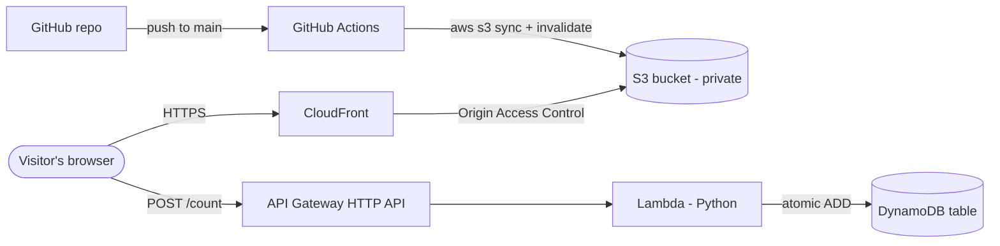

# Cloud Resume Challenge (AWS)

My résumé as a serverless website on AWS, with a live visitor counter and automatic deploys from GitHub.

**Live site:** https://YOUR-CLOUDFRONT-DOMAIN.cloudfront.net

## Architecture



| Service | What it does | Why I chose it |
|---|---|---|
| **S3** | Stores the HTML, CSS, and JS files. | Cheap, durable storage for static files. The bucket is fully private. |
| **CloudFront** | CDN in front of S3; serves the site over HTTPS. | Free TLS certificate, caching close to visitors, and Origin Access Control means S3 never has to be public. |
| **API Gateway (HTTP API)** | Public HTTPS endpoint `POST /count` that the page calls. | Lets the browser reach Lambda securely, with CORS locked to my CloudFront domain and throttling to cap abuse. |
| **Lambda (Python)** | Increments the counter and returns the new value. | No server to run; I pay only per request (free tier covers this easily). |
| **DynamoDB** | Holds a single item `{id: "resume", visits: N}`. | Serverless, on-demand billing; its `ADD` update is atomic, so simultaneous visitors don't lose counts. |
| **GitHub Actions** | Runs the Python tests, then syncs `site/` to S3 and clears the CloudFront cache on every push. | Deploys are automatic and repeatable. Logs in to AWS through OIDC, so no access keys are stored in GitHub. |
| **CloudFormation / SAM** | `infra/template.yaml` defines every AWS resource above. | Infrastructure as code: the whole stack can be rebuilt or deleted with one command. |

## Repo layout

```
site/            résumé page (index.html, styles.css, counter.js, config.js)
lambda/          visitor counter Lambda function
tests/           pytest tests for the Lambda (DynamoDB mocked with moto)
infra/           AWS SAM template for all AWS resources
.github/         GitHub Actions deploy workflow
docs/SETUP.md    step-by-step setup guide
```

## Running the tests locally

```bash
pip install -r tests/requirements.txt
pytest -q
```

See [docs/SETUP.md](docs/SETUP.md) for how to deploy it to your own AWS account.
